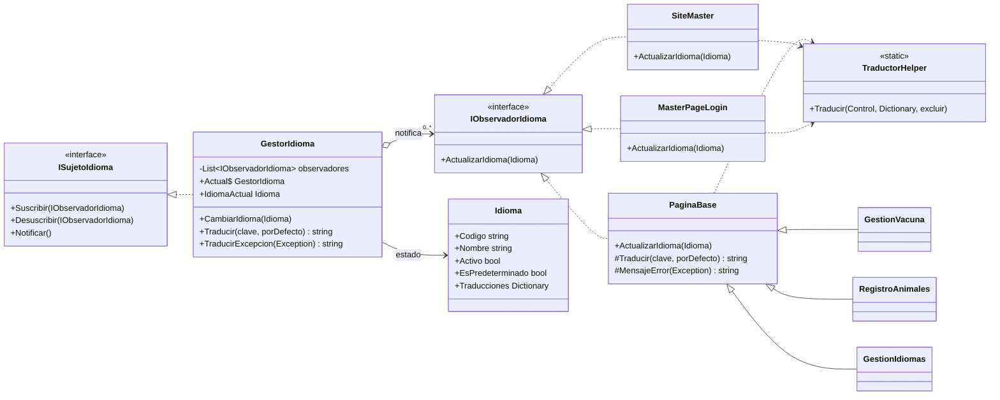
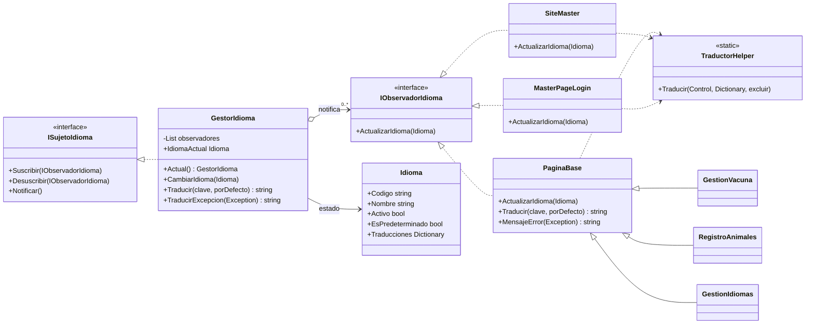

# ProyectoDAW_Barreto_Fernandez_Palermo

# 🌐 Multi-idioma con Patrón Observer

## Resumen
Se implementa la **traducción de todo el sitio** con el **patrón Observer** (requisito de la cátedra). Las traducciones se guardan en **SQL Server**, y hay una página nueva para administrar idiomas y traducciones con **baja lógica**.

Además, se corrigieron varios bugs encontrados durante las pruebas.

---

## 🧩 Patrón Observer

| Rol del patrón | Clase | Capa | Responsabilidad |
|---|---|---|---|
| **Sujeto (interfaz)** | `ISujetoIdioma` | SERVICIOS | `Suscribir`, `Desuscribir`, `Notificar` |
| **Sujeto concreto** | `GestorIdioma` | SERVICIOS | Guarda el idioma actual (en Session) y avisa a los observadores cuando cambia (`CambiarIdioma`). Hay una instancia por request. |
| **Observador (interfaz)** | `IObservadorIdioma` | SERVICIOS | `ActualizarIdioma(Idioma)` |
| **Observador concreto** | `PaginaBase` | GUI (App_Code) | Base de **todas las páginas**: traduce el contenido de la página |
| **Observador concreto** | `SiteMaster` / `MasterPageLogin` | GUI | Traducen la navbar (menú y selector de idioma) |
| Auxiliar | `TraductorHelper` | SERVICIOS | Recorre los controles y aplica los textos según `data-traduccion` |
| Auxiliar | `IdiomaHelper` | GUI (App_Code) | Carga el idioma desde la BLL y se lo pasa al sujeto |

### Diagrama de clases

### Diagrama de secuencia: el usuario cambia el idioma

> En cada request, `PaginaBase.OnPreRender` también llama a `Notificar()`, así todo se muestra en el idioma de la sesión aunque no haya cambiado.

---

## 🗄️ Base de datos
El script completo de la base es **`NUEVO_SCRIPT_OBSERVER.sql`** (reemplaza a `script.sql`).

| Tabla | Columnas | Descripción |
|---|---|---|
| `Idioma` | `ID`, `Codigo` (único), `Nombre`, `Activo`, `EsPredeterminado` | Idiomas del sistema. La baja es lógica (`Activo = 0`). |
| `Etiqueta` | `ID`, `Clave` (única), `Descripcion` | Catálogo de textos traducibles (clave legible) |
| `Traduccion` | `ID_Idioma`, `ID_Etiqueta`, `Texto` | Texto de cada etiqueta en cada idioma (PK compuesta, FK a ambas) |

**Permisos nuevos** (integrados a Roles y Familias):

| Clave | Web Master | AdminSuper |
|---|:-:|:-:|
| `IDIOMA_ALTA` | ✅ | ✅ |
| `IDIOMA_MODIFICAR` | ✅ | ✅ |
| `IDIOMA_BAJA` | ✅ | ✅ |
| `TRADUCCION_GESTIONAR` | ✅ | ✅ |
| `IDIOMA_REHABILITAR` | ✅ | ❌ |

`Usuario.lenguaje` ahora guarda el `Idioma.Codigo` (`es`, `en`, ...).

### Convención de claves (legibles)
`<pagina>_<tipo><Texto>`. Por ejemplo, `pageAnimal_btnBajaAnimal` es el botón de baja de RegistroAnimales.

| Tipo | Uso | Ejemplo |
|---|---|---|
| `tit` | Títulos y secciones | `pageVacuna_titVacunasRegistradas` |
| `lbl` | Labels | `pageLogin_lblContrasena` |
| `btn` | Botones | `pageIdiomas_btnAlta` |
| `col` | Columnas de grilla | `pageAdoptantes_colTelefono` |
| `opt` / `rb` | Opciones de listas y radios | `pageAnimal_optMacho` |
| `msg` | Mensajes del code-behind | `pageVacuna_msgVacunaRegistrada` |
| `menu` | Navbar | `master_menuIdiomas` |
| `<clase>_msg` | Mensajes de la BLL/DAL | `bllRol_msgPerfilSinPermisos` |

---

## 🖥️ Página nueva: `GestionIdiomas.aspx` (Administración → Idiomas)

| Sección | Funcionalidad |
|---|---|
| **Idiomas** | Alta, modificación, **baja lógica**, **rehabilitar** (solo Web Master) y marcar como predeterminado |
| **Traducciones** | Grilla filtrable por idioma y página: clave, texto predeterminado y traducción editable; guardar cambios |
| **Pendientes** | Un idioma nuevo arranca con todos los textos del predeterminado **entre corchetes** (`[Guardar cambios]`). "Marcar como pendiente" vuelve a ese estado. |

**Reglas de negocio**
- No se puede dar de baja el **último idioma activo** ni el **predeterminado**.
- El código del idioma es único, de 2 a 10 letras minúsculas.
- Si a un idioma le falta un texto, se muestra el del predeterminado.
- Cada operación queda registrada en la **Bitácora**.

---

## 🔁 Cambios en páginas existentes

| Cambio | Alcance |
|---|---|
| Heredan de `PaginaBase` en lugar de `Page` | Las 19 páginas |
| Atributo `data-traduccion` en labels, botones, títulos y opciones; `AccessibleHeaderText` en columnas | Todos los `.aspx` y las dos MasterPages |
| Mensajes del code-behind con `Traducir("clave", "texto")` | Todos los `.aspx.cs` |
| Errores mostrados con `MensajeError(ex)` (traduce los de la BLL/DAL) | `catch` de todas las páginas |
| Selector de idioma en la navbar | `MasterPage` y `MasterPageLogin` |
| Al iniciar sesión se aplica el idioma guardado del usuario | `Login.aspx.cs` |

**Mensajes de la BLL/DAL:** nueva `ExcepcionNegocio(clave, texto, parámetros)` en SERVICIOS. Los ~70 `throw new Exception("...")` pasaron a usarla.

---

## 🐛 Fixes incluidos

| Bug | Causa | Solución |
|---|---|---|
| Crash al seleccionar un animal en RegistroAnimales | La grilla codifica `Pequeño` como `Peque&#241;o` y no coincidía con el desplegable | Decodificar el texto de las celdas y seleccionar de forma segura. Se aplicó también a Adoptantes, Usuarios y Vacunas, que guardaban los acentos codificados. |
| Rol "Normal" sin salida: no se podía vaciar ni eliminar | Regla de "al menos un permiso" + no se puede eliminar un rol con usuarios | Un rol o familia **en uso** puede quedar vacío |
| Error y éxito visibles a la vez en RolesFamilias | El panel de éxito no se ocultaba | Se muestra un solo panel por vez |
| Opción del selector de idioma ilegible | Fondo transparente en el `<select>` | Fondo sólido y opciones con fondo blanco |

---

## 📁 Archivos nuevos

| Capa | Archivos |
|---|---|
| BE | `Idioma.cs`, `Etiqueta.cs`, `Traduccion.cs` |
| DAL | `dalIdioma.cs`, `dalTraduccion.cs` |
| BLL | `bllIdioma.cs`, `bllTraduccion.cs` |
| SERVICIOS | `ISujetoIdioma.cs`, `IObservadorIdioma.cs`, `GestorIdioma.cs`, `TraductorHelper.cs`, `ExcepcionNegocio.cs` |
| GUI | `App_Code/PaginaBase.cs`, `App_Code/IdiomaHelper.cs`, `GestionIdiomas.aspx(.cs)`, `Estilos/EstilosIdiomas.css` |
| BD | `NUEVO_SCRIPT_OBSERVER.sql` |

---

## ✅ Cómo probar
1. Ejecutar `NUEVO_SCRIPT_OBSERVER.sql` en SQL Server.
2. Compilar la solución y entrar al sitio.
3. Cambiar el idioma en la navbar: la navbar y la página se traducen en el mismo postback, y el idioma se mantiene al navegar.
4. Iniciar sesión: se aplica el idioma guardado del usuario.
5. En **Administración → Idiomas**:
   - Crear un idioma (por ejemplo `pt`): sus textos aparecen como `[...]`.
   - Traducir algunos textos y verificar que el cambio se ve en el sitio.
6. Intentar dar de baja el idioma predeterminado o el último activo: el sistema lo rechaza.
7. Rehabilitar un idioma: solo funciona con Web Master.
8. Con el sitio en inglés, provocar un error de la BLL (por ejemplo, eliminar un rol con usuarios): el mensaje sale en inglés.

✻ Sautéed for 2m 10s · done jueves, 12:12

> Unable to render rich display

  Parse error on line 21:
  ...tring } #Traducir(clave, por
  ---------------------^
  Expecting 'EOF', 'acc_title', 'acc_descr', 'acc_descr_multiline_value', 'NAMESPACE', 'ANNOTATION_START', 'CLASS', 'MEMBER', 'SEPARATOR', 'NOTE_FOR', 'NOTE', 'CLASSDEF', 'ALPHA',
| Rol "Normal" sin salida: no se podía vaciar ni eliminar | Regla de "al menos un permiso" + no se puede eliminar un rol con usuarios | Un rol o familia **en uso** puede quedar vacío |
| Error y éxito visibles a la vez en RolesFamilias | El panel de éxito no se ocultaba | Se muestra un solo panel por vez |
| Opción del selector de idioma ilegible | Fondo transparente en el `<select>` | Fondo sólido y opciones con fondo blanco |

---

## 📁 Archivos nuevos

| Capa | Archivos |
|---|---|
| BE | `Idioma.cs`, `Etiqueta.cs`, `Traduccion.cs` |
| DAL | `dalIdioma.cs`, `dalTraduccion.cs` |
| BLL | `bllIdioma.cs`, `bllTraduccion.cs` |
| SERVICIOS | `ISujetoIdioma.cs`, `IObservadorIdioma.cs`, `GestorIdioma.cs`, `TraductorHelper.cs`, `ExcepcionNegocio.cs` |
| GUI | `App_Code/PaginaBase.cs`, `App_Code/IdiomaHelper.cs`, `GestionIdiomas.aspx(.cs)`, `Estilos/EstilosIdiomas.css` |
| BD | `NUEVO_SCRIPT_OBSERVER.sql` |

---
